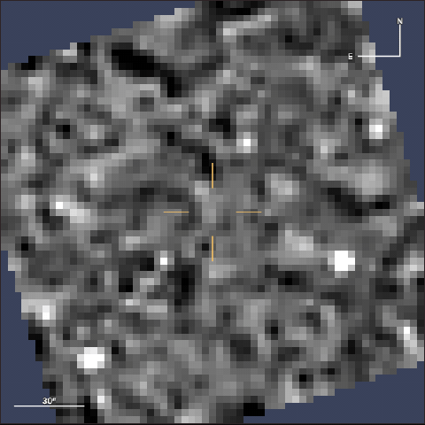
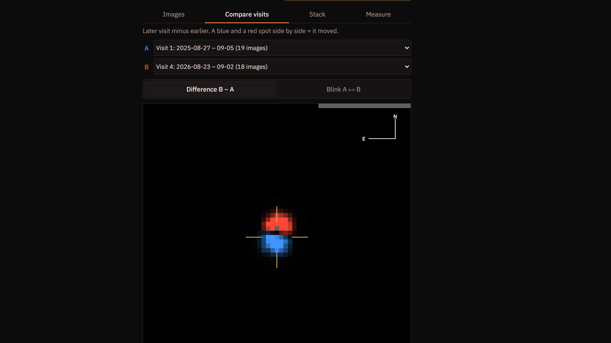
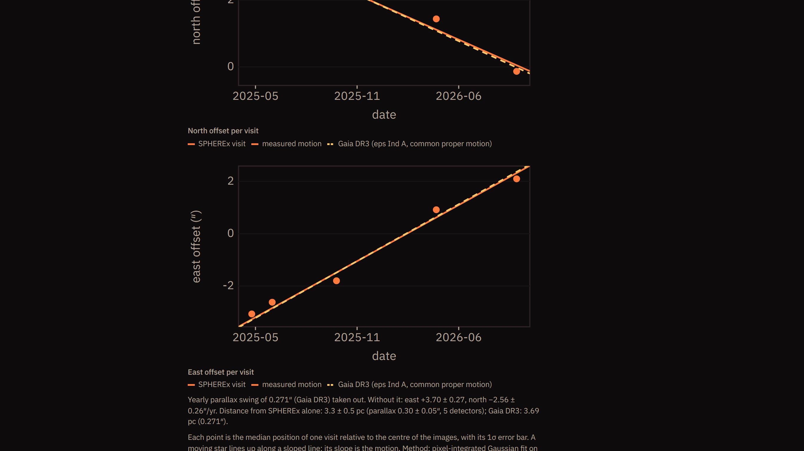

# Watch the Sky Change

Team OSU's project for the [NASA Space Apps Challenge 2026](https://www.spaceappschallenge.org/2026/challenges/planet-x-and-spherex/),
challenge "Planet X and SPHEREx" (Ulaanbaatar local event).

**Try it:** https://osu-spherex.vercel.app (mirror: https://osu-spherex.onrender.com).
How it works, results and limits: https://osu-spherex.vercel.app/method

NASA's SPHEREx telescope photographs the whole sky again and again, so anything that moves or changes brightness
leaves a trace in its images. This web tool lets anyone look for those traces in a browser: give it a sky position,
and it collects every SPHEREx image of that spot, lines them up, plays them as a film, subtracts one visit from
another, adds dozens of images along a motion so that a faint object appears, and measures the motion and the
brightness as numbers that can be compared with published catalogues.



*WISE 0855, a cold brown dwarf: one SPHEREx image, where it is lost in the noise, and the stack of all 45 images
along its motion, where it stands out.*

| Compare visits | Measure |
| --- | --- |
|  |  |
| The last visit minus the first: Barnard's Star leaves a blue spot where it was and a red one where it is a year later. | Epsilon Indi B: its position in each visit follows the catalogue motion, and the yearly parallax swing gives its distance from SPHEREx images alone. |

More pictures and a 30-second silent tour: [`docs/media/`](docs/media/README.md).

## What it does

Step by step:

- Type a sky position (RA, Dec) or pick one of the five challenge objects. The tool collects every SPHEREx image of
  that spot, lines them up on one grid and plays them in time order.
- **Compare visits** subtracts one visit from another, so a small shift becomes a dark-and-bright pair. A SPHEREx
  pixel is 6.16 arcseconds and the fastest star in the sky, Barnard's Star, moves about 10.4 arcseconds per year, so
  a film alone barely shows it.
- **Stack** adds the images along a chosen motion (shift-and-stack), so an object too faint for any single image can
  appear. **Search** tries a grid of motions and tests the best one against the same images with shuffled dates.
- **Measure** gives the motion in arcseconds per year and the brightness over time. Every SPHEREx image sees a source
  at a different wavelength, so brightness is compared only between images at matching wavelength; the same points
  plotted against wavelength give a spectrum.

The five challenge objects (Barnard's Star, WISE 0855−0714, Epsilon Indi B, RW Aurigae, R Draconis) are prepared in
advance and marked "from cache" on the site. Any other position is fetched from the archive when you ask.

## Does it give the right answer?

The challenge names five objects to test with. These are the tool's measurements on them, next to published values.
The files they come from are in `data/cubes/<object>/` (`motion.json`, `<detector>/measure.json`) and
`frontend/search/results.json`; the site shows the same numbers.

| Object | What the tool measures from SPHEREx images | Published value |
| --- | --- | --- |
| Barnard's Star, motion north | +10.26 ± 0.15 arcsec/yr (six detectors together) | +10.36 (Gaia DR3) |
| Barnard's Star, motion east | −1.26 ± 0.38 arcsec/yr; poorly constrained in the four detectors where the star saturates, and the tool flags it | −0.80 (Gaia DR3) |
| Epsilon Indi B, motion | +3.93 ± 0.07 east, −2.54 ± 0.05 north arcsec/yr (five detectors together) | +3.97, −2.54 for Epsilon Indi A, the star it travels with (Gaia DR3) |
| Epsilon Indi B, distance | parallax 0.30 ± 0.05 arcsec, so 3.3 parsecs | 0.271 arcsec, 3.7 parsecs (Gaia DR3) |
| WISE 0855−0714, motion | invisible in single images. The search, told nothing about the direction, picks (−8.7, +0.2) arcsec/yr with a grid step of 3; none of 500 shuffled date orders scores as high | (−7.97, +0.81) (CatWISE2020), 0.9 away |
| RW Aurigae, brightness | 2.5 times brighter in September 2026 than in September 2025, at 0.74–0.76 micrometres | a known variable star |
| R Draconis, brightness | a factor of 3.9 between its bright and faint states, at 0.94–0.96 micrometres | a Mira variable with a 245.6-day period (GCVS) |
| Control: a star with no catalogued motion, 1.3 arcminutes from Barnard's Star | stays within 0.16 arcsec of its position in all four visits; its brightness changes by 3% at a typical wavelength | no motion |
| Control: empty sky next to WISE 0855 | the search reports nothing found | nothing there |

From the same images the tool draws a spectrum: Epsilon Indi B's has a dip near 1.4 micrometres, about 6 mJy there
against about 40 mJy at 1.27 and 1.57 micrometres.

## Honest limits

- One year of data and 6-arcsecond pixels: only fast or bright movers can be measured directly.
- The motion search does not model parallax, so it finds nearby fast objects. A distant planet, which swings by
  arcminutes a year as the Earth moves, needs a wider search that does.
- The parallax of Barnard's Star could not be measured (0.0 ± 0.3 arcsec against 0.547): in one of its visits the
  positions are damaged along detector rows, and we did not find the cause.
- For a position typed by the user, the motion is fitted without the parallax correction; only the prepared examples
  have it, where Gaia gives a parallax.
- On a star that saturates the detector the motion search is not stable: for Barnard's Star it lands 1.7 arcsec/yr
  from the catalogue value, with a grid step of 3.
- When the archive's image search does not answer, as on 15 November 2026, only positions near the five examples
  work, from a saved list of images.
- The archive serves two processing versions (Data Release 1 for images up to May 2026, Quick Release 3 for later
  ones), whose brightness scales differ by about 3%, so the tool does not claim changes smaller than about 4%.

## What is in this repository

| Folder | What |
| --- | --- |
| `data/` | Python pipeline: archive query, cutouts, alignment (`cube.py`), motion (`motion.py`), brightness (`photometry.py`), catalogues |
| `data/cubes/` | Ready-made image cubes and measurements of the example objects (real SPHEREx data) |
| `backend/` | FastAPI service: builds a cube for any position from IRSA, with retries and a disk cache |
| `frontend/` | Next.js site. `viewer/`: canvas viewer; `search/`: shift-and-stack and the motion search |
| `tests/`, `backend/tests/` | Python tests; the frontend tests sit next to the code (`*.test.ts`) |
| `experiments/` | Short scripts written before the event to check that the data were usable |
| `docs/` | Architecture and data format, comparison of data releases, method of the motion search |

Most of `docs/` and some comments are in Mongolian, the team's working language. Comments mention internal planning
files (`CLAUDE.md`, `tasks/`, `docs/DECISIONS.md`) that are not part of this public copy.

## Run it

The site with the five examples needs only Node.js 22 or newer:

```bash
cd frontend
npm ci
npm run dev                       # http://localhost:3000
```

The cubes of the five examples are copied from `data/cubes/` into the site before it starts, so this works without
the backend and without the archive. For any other sky position, run the backend as well (Python 3.12 or newer) and
point the site at it:

```bash
python -m venv .venv
.venv/Scripts/activate            # Windows; on macOS/Linux: source .venv/bin/activate
pip install -r backend/requirements.txt
python -m pytest backend/tests -q
python -m uvicorn backend.app:app --port 8000     # http://127.0.0.1:8000/health
```

```bash
cd frontend
cp .env.example .env.local        # points the site at the local backend
npm ci
npm test
npm run dev                       # http://localhost:3000
```

`npm run build` makes the production build.

`python -m pytest tests -q -m "not network"` runs the tests of the data pipeline without contacting the archive
(leave the `-m` option out to include the two tests that query IRSA). Tests that need the original SPHEREx cutouts
(about 3 GB, not in this repository) are skipped unless the cutouts have been downloaded with
`python experiments/prefetch_cache.py`. `docs/UPDATING.md` explains how to rebuild the cubes when the archive
publishes new data.

## Data and credits

- **NASA SPHEREx** Level 2 spectral images, from the
  [NASA/IPAC Infrared Science Archive (IRSA)](https://irsa.ipac.caltech.edu/Missions/spherex.html): the only images
  the tool uses, found with IRSA's TAP service and downloaded with its cutout service. No data are simulated;
  synthetic images appear only inside automated tests. `data/listings/` holds the list of images IRSA gave for the
  five examples on 14 November 2026; the site uses it, and says so, when IRSA's search does not answer.

  This publication makes use of data products from the Spectro-Photometer for the History of the Universe, Epoch of
  Reionization and Ices Explorer (SPHEREx), which is a joint project of the Jet Propulsion Laboratory and the
  California Institute of Technology, and is funded by the National Aeronautics and Space Administration.
- **ESA Gaia DR3** (https://www.cosmos.esa.int/web/gaia/dr3) and **CatWISE2020** (Marocco et al. 2021,
  https://arxiv.org/abs/2012.13084), both queried through IRSA: reference positions and proper motions used to check
  the results and to mark known moving objects. The Gaia parallaxes in `data/cubes/*/catalog.json` were taken from the
  ESA Gaia Archive (https://gea.esac.esa.int/archive/) on 15 November 2026, when IRSA's search was down.
- Spitzer astrometry of WISE 0855−0714, used to choose between duplicate CatWISE2020 entries: Kirkpatrick et al. 2021
  (https://arxiv.org/abs/2011.11616) and Luhman & Esplin 2016 (https://arxiv.org/abs/1605.06655). The 2MASS Point
  Source Catalog, through IRSA, for the 1999 position of Epsilon Indi B in `experiments/`.
- Software, all open source: [Astropy](https://www.astropy.org), [reproject](https://reproject.readthedocs.io),
  astroquery, PyVO, NumPy, SciPy, Matplotlib, FastAPI; Next.js, React, TypeScript and Vitest for the site, which
  loads the fonts Unbounded, IBM Plex Sans and IBM Plex Mono (SIL Open Font License).
- The task and the five test objects: NASA Space Apps Challenge 2026, "Planet X and SPHEREx".

## How AI was used

We used **Claude**, the AI model made by Anthropic, throughout the project: the Claude Code programming assistant on
each developer's computer, and a Claude project for planning.

- **What the AI did.** Most of the source code, the automated tests and the technical documentation in this
  repository, this README included, were written by Claude under the direction of team members. Claude also ran the
  first checks of the data, proposed the architecture, split the work into tasks and reviewed changes.
- **What people did.** Team members chose the challenge, set the priorities and made the design decisions. Every
  finished task had a human check: a team member looked at the result and had to be able to explain it. Tests whose
  answers are known from outside sources, such as the catalogue motion of Barnard's Star, were fixed before the code
  was written and may only be changed by a person.
- **How it is marked.** In the team's development repository, changes made with Claude carry a
  "Co-Authored-By: Claude" line. This public copy has no commit history, so the statement is made here instead: treat
  every source file in this repository as AI-assisted.
- **What AI was not used for.** No images, video, audio or voices were generated by AI. All astronomical data are
  real SPHEREx observations.

## About this copy

This is a snapshot of the team's private development repository at commit `3f0bfef` (2026-11-15), published without
its commit history. Internal planning notes and progress logs, which name team members, are left out. Two lines of
comments (in `data/control_cube.py` and `frontend/viewer/README.md`) still used an earlier name of the motion search;
they are reworded in this copy. Apart from those two lines and this README, the files here are as they are in that
commit.

## License

The code is released under the [MIT License](LICENSE), copyright Team OSU. The files in `data/cubes/` are derived
from SPHEREx data served by IRSA; for their use, follow the terms and acknowledgements of the archive.
