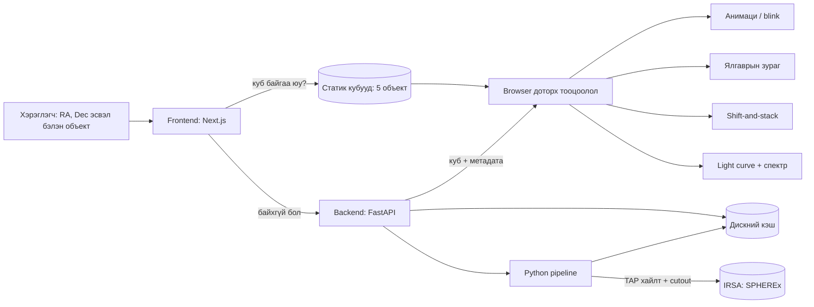

# Архитектурын төлөвлөгөө (v1, 2026-11-10)

Төлөв: **санал**. Багаараа хэлэлцээд өөрчилж болно; өөрчилбөл `DECISIONS.md`-д тэмдэглэнэ.
11/10-ны туршилтуудын үр дүнд (`CLAUDE.md` → "5 объектын шалгалт") тулгуурласан.

## Гол санаа: тооцооллын хүнд хэсэг Python-д, харилцан үйлдэл бүгд browser-т

Backend нэг удаа **тэгшилсэн жижиг "куб"** (N зураг × 61 × 61 пиксел, ~1 MB) бэлдэж өгнө.
Анимаци, ялгавар, давхарлалт, өнгөний тохиргоо бүгд browser дотор JavaScript-ээр шууд тооцогдоно.

Яагаад:
- IRSA удаан (хайлт ~30 сек, cutout бүр 3–5 сек). Товч дарах бүрт серверээс хүлээвэл хэрэгсэл ашиглах аргагүй.
- Давхарлалт, ялгавар нь энгийн массивын үйлдэл → манай багийн хүчтэй тал (JS) дээр бууна.
- 5 туршилтын объектын кубыг урьдчилан бэлдэж **статик файл** болгон тавьж болно → backend унтарсан ч демо ажиллана.



## Өгөгдлийн түвшнүүд

| Түвшин | Юу | Хаана үүснэ | Тайлбар |
| --- | --- | --- | --- |
| L0 | Түүхий cutout (FITS) | IRSA → `data/cache/` | Өөрчлөхгүй хадгална |
| L1 | Тэгшилсэн куб | Python (`reproject`) | Бүх зураг нэг сүлжээнд (хойд зүг дээшээ, 3″/px, 61×61), дэвсгэр хассан. Зураг бүрт: `mjd`, `band`, `lam` (төвийн долгионы урт), `noise`, `nan_frac` |
| L2 | Epoch нийлбэр | Browser | Нэг цагийн бүлгийн зургуудын медиан → өргөн зурвасын мэт цэвэр зураг (долгионы уртын ялгааг дундажлана) |
| L3 | Хэмжилт | Python (түүхий L0 дээр) | Сонгосон эх үүсвэрийн байрлал (epoch бүрт), урсгал (зураг бүрт), ханасан бол wing flux |

Анхаар: хэмжилтийг (L3) тэгшилсэн куб дээр биш **түүхий зураг дээр** хийнэ — reproject нь пикселийг
жигдрүүлж байрлал, урсгалыг гажуудуулна. Куб бол зөвхөн харуулах зориулалттай.

## Интерфейс (багийн гишүүд зэрэг ажиллахын тулд эхний 1 цагт тохирно)

```
GET /api/cube?ra=..&dec=..&band=D1        → { status, progress } эсвэл куб
    cube.json: { center:{ra,dec}, pixscale_arcsec, shape:[N,H,W],
                 frames:[{ id, band, mjd, lam_um, noise, nan_frac }], data_url }
    cube.f32 : Float32Array, N×H×W (MJy/sr, NaN = хүчингүй пиксел)
    нэмэлт (11/15, C-12/C-13; зөвхөн /api-ийн хариунд): n_images, n_frames, n_failed (архив өгөөгүй зураг),
                 listing:"saved", listed (хайлт унасан үед хадгалсан жагсаалт ашигласан бол)

GET /api/measure?ra=..&dec=..&band=D1     → { epochs:[{mjd, ra, dec, err_arcsec}],
                                              motion:{pm_ra, pm_dec, err},        // arcsec/yr
                                              photometry:[{mjd, lam_um, flux, method:"aperture"|"wing"}] }
```

### Интерфейсийн нэмэлт (2026-11-14 14:30, төлөвлөгч; бүгд **нэмэлт** — одоо байгаа талбар, хаяг өөрчлөгдөхгүй)

NASA-ийн нэмэлт саналуудыг (`docs/REQUIREMENTS.md`, O1–O7) хаахын тулд. Хуучин клиент шинэ талбарыг үл тоож ажиллана.

```
Талбарын хэмжээ (O4)
  GET /api/cube?ra&dec&band=D1&fov=3|6|10      fov = талбарын өргөн, нуман минут; анхдагч 3
  GET /api/measure?...&fov=...                  (хэмжилт fov-оос хамаарахгүй; зөвхөн кэшийн түлхүүрт)
  cube.json: shape:[N,H,W], H = W = fov*20 + 1  (3′ → 61, 6′ → 121, 10′ → 201; pixscale 3″ хэвээр),
             fov_arcmin: 3|6|10
             frames[].center_cover (зөвхөн 6′, 10′; A-15): дунд 61×61 пикселийн (3′ талбар — давхарлалт, хайлт
             ажилладаг хайрцаг) өгөгдөлтэй хэсгийн хувь, 0..1. 3′ кубд бичихгүй (тэнд 1 − nan_frac ижил утгатай).
             Ирмэг нь хоосон (nan_frac их) frame-ийг кубаас хасдаггүй.
  Viewer аль ч H, W-тэй ажиллах ёстой (61 гэж хатуу бүү бич).

Зургаан детектор (O2)
  Статик: /cubes/<obj>/D1 … D6/{cube.json, cube.f32, measure.json}   (ижил төв, ижил тор)
          /cubes/<obj>/spectrum.json = { object, unit, note,
              points:[{ band, mjd, epoch, lam_um, flux, err, ok, why }] }   // бүх детектор, 0.75–5.0 µm
  Шууд:   /api/measure-ийг детектор бүрт дуудаж frontend нэгтгэнэ (шинэ endpoint хэрэггүй).

Каталогийн давхарга (O5)
  Статик: /cubes/<obj>/catalog.json      Шууд: GET /api/catalog?ra&dec&radius=<arcsec>
  { center:{ra,dec}, radius_arcsec, sources:[{ cat:"gaia_dr3"|"catwise2020", id, ra, dec,
      epoch,            // байрлалын огноо, жилээр (Gaia DR3: 2016.0)
      pm_ra, pm_dec,    // arcsec/yr, pm_ra нь cos(dec)-тэй; байхгүй бол null
      mag, mag_band,    // жишээ нь G, W2
      parallax }],      // A-14: зөвхөн Gaia, arcsec; байхгүй бол null эсвэл талбар байхгүй (CatWISE)
    source:{ archive, queried_utc } }
  Viewer эх үүсвэрийг кубын frame-ийн огноо руу pm-ээр шилжүүлж тэмдэглэнэ.

Параллакс (A-14; нэмэлт талбарууд, хуучин талбар өөрчлөгдөөгүй)
  measure.json motion: { pm_ra, pm_dec, err_ra, err_dec, …  // каталогийн параллаксыг ТОГТМОЛ барьсан тохируулга
      parallax_arcsec, parallax_source,       // 0 ба null = параллаксгүй шулуун (каталогт байхгүй, /api/measure)
      no_parallax:{ pm_ra, pm_dec, err_ra, err_dec },   // ижил тохируулга параллаксгүйгээр
      parallax_fit: null | { parallax_arcsec, err, pm_ra, pm_dec, err_ra, err_dec, chi2, dof },  // параллакс чөлөөт
      detector_agreement: null | { n, chi2_ra, chi2_dec, dof, scale_ra, scale_dec },
      err_ra_fit, err_dec_fit }               // зөвхөн алдааг өргөсгөсөн үед: өргөсгөхөөс өмнөх утга
  Статик: /cubes/<obj>/motion.json = { object, parallax_arcsec, parallax_source, note,
      detectors:[{ band, status, n_epochs, pm_ra, err_ra, pm_dec, err_dec, no_parallax, parallax_fit }],
      combined: null | { bands, pm_ra, err_ra, pm_dec, err_dec, chi2_ra, chi2_dec },   // "ok" детекторуудын жинлэсэн дундаж
      parallax_measured: null | { bands, parallax_arcsec, err, scatter, n_independent, sigma, distance_pc } }

Flag (O7)
  cube.json: flag_names:{ "<bit>": "<нэр>" }, frames[].flags:{ any_frac, center_bits:[bit,…] }
             // any_frac = төвөөс 15″ доторх flag-тай пикселийн хувь; center_bits = тэнд тавигдсан bit-үүд
             flags_url:"flags.u8"  (заавал биш)  Uint8, N×H×W, 1 = тухайн пикселд аль нэг flag (nearest-neighbour)

Embed (O6)
  ?embed=1  → гарчиг, тайлбар, оролтгүй, зөвхөн Viewer (бусад параметр хэвээр: object | ra, dec, band, fov)
```

Статик кубууд яг ижил форматтай (`/cubes/barnard/D1/cube.json`), тиймээс frontend хоёр эх
сурвалжийг ялгахгүй. Frontend-ийнхэн backend бэлэн болохыг хүлээлгүй статик кубаар ажиллана.

## Хэрэглэгчийн харах зүйлс

| # | Функц | Аль объектыг харуулах | Зэрэглэл |
| --- | --- | --- | --- |
| 1 | Координат оруулах (+ 5 бэлэн объектын товч, URL-д `?ra=&dec=`) | бүгд | **MVP** |
| 2 | Epoch анимаци / blink, детектор сонгох, тод байдлын тохиргоо | Barnard, eps Ind B | **MVP** |
| 3 | Ялгаврын зураг (epoch B − epoch A) | Barnard, eps Ind B | **MVP** |
| 4 | Shift-and-stack: хөдөлгөөний векторыг гараар тохируулж давхарлах | WISE 0855 | **Заавал** |
| 5 | Эх үүсвэр дээр дарж хэмжих: хөдөлгөөн (″/жил), light curve (ижил долгионы уртын бинд) | RW Aur, R Dra, Barnard | **Заавал** |
| 6 | Спектр (урсгал ба долгионы урт) | eps Ind B | Нэмэлт (NASA "extra kudos") |
| 7 | Хурдны автомат хайлт: олон векторыг туршиж хамгийн тод илрүүлэлтийг олох ("Planet X горим") | WISE 0855 | Нэмэлт, Creativity-д хамгийн хүчтэй |
| 8 | Aladin Lite: бусад дурангийн зураг, Gaia/WISE каталогийн давхарга | бүгд | Нэмэлт |
| 9 | Олон нийтэд зориулсан тайлбарууд, өгөгдлийн эх сурвалж, "кэшээс" тэмдэг | бүгд | **MVP** (богино) |

Дүрэм: "Заавал" бүгд дуустал "Нэмэлт" рүү орохгүй. 5 объект бүгд ажиллаж байгаа нь Validity-ийн үндэс.

## Цагийн төлөвлөгөө (~31 цаг; 11/13-ны оройн шинэ хуваариар)

| Хэзээ | Зорилго |
| --- | --- |
| Бя 09:00–09:30 | Zoom session (бүгд). **09:00-аас код бичиж болно.** Хэн нэг нь Render-ийг сэрээнэ |
| Бя 09:30–11:00 | Интерфейсийг батлах, Next.js скелет (D-01, 10:00), 5 объектын статик куб (A-01, A-02, 11:00) |
| Бя 11:00–16:00 | MVP: L1 pipeline, `/api/cube`, анимаци + ялгавар. Багийн шалгалт 12:00, 16:00 |
| Бя 16:00–20:00 | Shift-and-stack, `/api/measure` (хөдөлгөөн), deploy-ийн эхний хувилбар. 20:00 шалгалт + илтгэлийн 1-р давтлага |
| Бя 20:00–24:00 | Light curve (wing flux орно), дутуу "Заавал" функцүүд |
| Ня 09:00–13:00 | Тайлбарууд, гар утас, нэг нэмэлт функц. Багийн шалгалт 10:00, 13:00 |
| Ня 13:00–16:30 | Алдаа засах, FAQ, слайд. **16:30 код царцаана** |
| Ня 16:30–18:00 | Нэргүй public repo (A-04), маягтын текст (A-05), нөөц видео; 17:30 бүтэн давтлага |
| Ня 18:00–18:30 | Check-in |
| Ня 18:30–19:30 | **Орон нутгийн илгээлт** (ноорог байж болно) |
| Ня 19:30–20:30 | **Zoom-оор шууд илтгэл** (англиар) |
| Ня 21:30–23:30 | Шүүгчдийн санал дээр зөвхөн эрсдэлгүй засвар, эцсийн шалгалт |
| Ня 23:59-өөс өмнө | **NASA-ийн илгээлт.** Линк нь нэргүй цэвэр public repo (A-04), энэ private repo биш |

## Гадны үйлчилгээний найдвартай байдал (11/10-нд шалгасан)

11/10-нд CDS (Страсбург)-ийн серверүүд бүхэлдээ ажиллахгүй байсан: SIMBAD, VizieR, Aladin-ий `alasky`.
Хакатоны үеэр давтагдаж болно, тиймээс **гол зам дээр CDS-ээс бүү хамаар.**

| Хэрэгцээ | Үндсэн | Нөөц / тэмдэглэл |
| --- | --- | --- |
| SPHEREx зураг | IRSA (TAP + cutout) | 503 байнга гардаг → дахин оролдох; 5 объект `data/cache/`-д бий |
| Нэрээр хайх, байрлал, PM | `simbad.cfa.harvard.edu` (Harvard толь, TAP ажилласан) | `simbad.cds.unistra.fr`; 5 объектын утгыг кодонд хатуу бичиж болно |
| Каталог (GCVS гэх мэт) | `vizier.cfa.harvard.edu` | `vizier.cds.unistra.fr` |
| Gaia, CatWISE, 2MASS каталог | IRSA (`gaia_dr3_source`, `catwise_2020`) | — |
| Бусад дурангийн дэвсгэр зураг (HiPS) | `irsa.ipac.caltech.edu/data/hips/CDS/...` (2MASS, AllWISE, DSS2) | CDS `alasky` |
| Aladin Lite | `cdn.jsdelivr.net/npm/aladin-lite@3/dist/aladin.js` (**ES module**; `.umd.cjs` нь browser-т ачаалагдахгүй) | CDS унтарсан үед дэвсгэр зураг нь IRSA-ийн HiPS заасан ч **ачаалагдаагүй** (анхдагч DSS давхарга ба `alasky` MocServer-ийг хүлээгээд гацсан). Тэмдэглэгээ, удирдлага ажилласан |
| AAVSO (хувьсах одны ажиглалт) | Гараар татах | Cloudflare скриптийг хаадаг, автоматаар татах боломжгүй |

Дүгнэлт: SPHEREx-ийн үндсэн харуулагч нь **өөрсдийн canvas** байна (Aladin Lite биш). Aladin Lite бол
зөвхөн "Нэмэлт" (#8), CDS ажиллаж байвал асаана.

## Нээлттэй асуултууд

- **Байршуулалт (11/10-нд туршсан):** Frontend → Vercel; Python backend → **Render, free plan, Oregon** ажиллана.
  Хэмжилт (`experiments/deploy_probe/`): санах ой 145 MB / 512 MB; TAP хайлт 8–14 сек; cutout 1.5–2.3 сек
  (Монголоос 3–5 сек — Oregon нь IRSA-д ойр); reproject 0.01 сек. Сул тал: хүйтэн эхлэлт ~1 мин
  (сангуудыг импортлоход 19 сек), 15 мин идэвхгүй бол унтана, диск түр зуурынх. IRSA эхний оролдлогод
  4/4 cutout-д 503 буцаасан, дахин оролдоход бүгд орсон → **дахин оролдох логик заавал**.
  Статик кубууд эдгээр эрсдэлийг бууруулна, гэхдээ дурын координатын шууд хайлтыг ядаж нэг удаа демо хийх ёстой;
  демоны өмнө сервисийг "сэрээх" хүсэлт явуулна.
- **Дурын координатын хайлт ~1 минут.** Явцын мөр заавал; боломжтой бол зураг ирэх бүрд нь нэмж харуулах.
- **IRSA-ийн хүсэлтийн хязгаар** тодорхойгүй. 8-аас их зэрэгцээ хүсэлт бүү явуул.
- **Урьдчилан бичсэн кодын дүрэм** (зохион байгуулагч, 11/13): судлах, төлөвлөхийг өмнө нь хийж болно, бодит
  хөгжүүлэлт Бя 09:00-аас. Тиймээс `data/`, `backend/`, `frontend/`-ийн код ба статик кубыг 09:00-аас хойш үүсгэнэ;
  `experiments/` нь хакатоны өмнөх судалгаа, илгээлтэд тэгж тайлбарлана.
- **Impact сул.** Илтгэлийн гол санаа: "Плутоныг ингэж нээсэн; одоо хэн ч, гар утаснаасаа".
